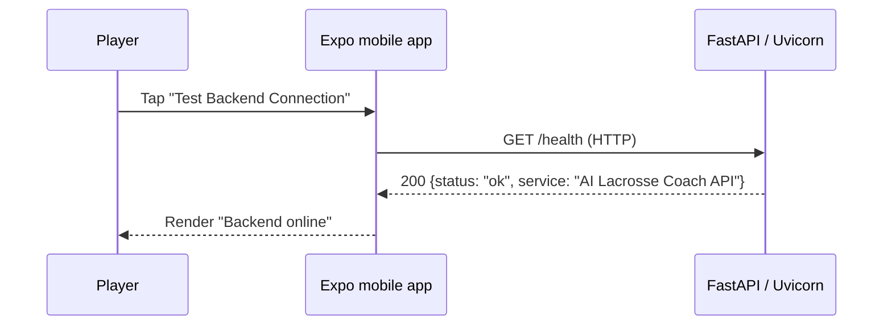
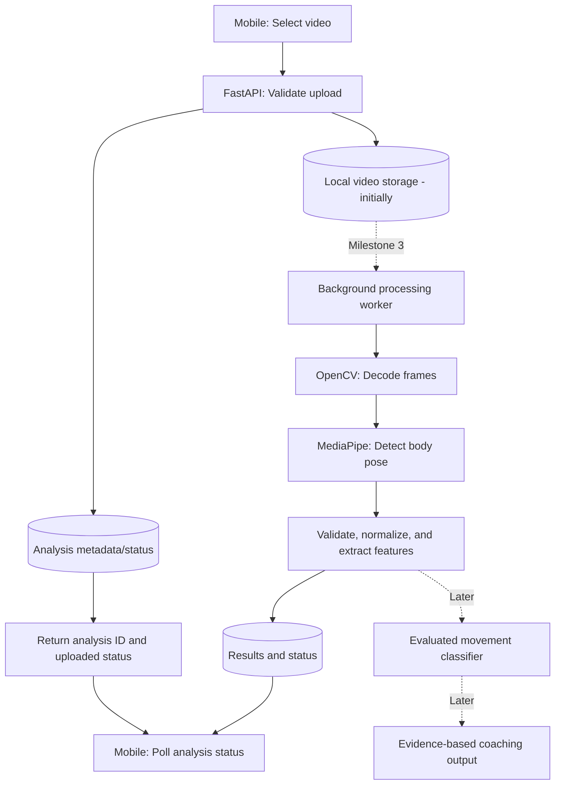

# AI Lacrosse Coach — System Architecture

**Updated:** November 9, 2026<br>
**Status:** Milestone 1 implementation with a documented future design

## 1. Purpose and scope

This document explains how the project's parts communicate, what is **implemented now**, and what is **planned**. It intentionally describes a practical starting architecture instead of treating speculative AI components as already working.

### Current capabilities (verified during Milestone 1)

- Expo/React Native mobile application running in Expo Go on an iPhone.
- FastAPI server running locally through Uvicorn.
- `GET /health` returning a JSON status and service name.
- Mobile app sending a request over the local network and showing a connection status.

### Not implemented yet

Video uploading, persistent analysis jobs, frame decoding, pose estimation, stick tracking, machine learning, coaching feedback, accounts, databases, cloud storage, and production hosting.

## 2. Architectural style

**Monorepo + modular monolith.** Both applications are committed together, but each runs independently.

```text
Capstone/
├── apps/mobile/
│   ├── src/app/                  # Expo Router screens (index.tsx, _layout.tsx, etc.)
│   ├── src/components/           # Reusable React Native components
│   ├── app.json                  # Expo and EAS configuration
│   ├── package.json              # Frontend dependencies/scripts
│   └── .env.local                # Developer-specific API address; ignored by Git
├── services/backend/
│   ├── src/backend/
│   │   ├── __init__.py
│   │   └── main.py               # FastAPI instance and /health handler
│   ├── pyproject.toml            # Python project/dependencies
│   └── uv.lock                   # Reproducible Python dependencies
├── docs/
│   ├── architecture.md
│   └── roadmap.md
└── README.md
```

No Docker containers, microservices, message broker, database, or cloud infrastructure are required to make the initial HTTP connection work.

### Responsibilities

| Area | Owns | Should not own |
| --- | --- | --- |
| Mobile (`apps/mobile`) | UI, device permissions, video selection, request lifecycle, result presentation | Python inference, trusted validation, model training |
| FastAPI (`services/backend`) | API contracts, input validation, IDs/status, orchestration, HTTP errors | Rendering the mobile UI |
| Vision module (planned, backend-side) | Frame decoding, pose estimation, quality checks, landmarks | HTTP request/response objects |
| Analysis module (planned) | Movement features, evaluated model inference | Device navigation, file upload transport |
| Storage/persistence (planned) | Video blobs, metadata, analysis results, retention | Coaching logic |

**Design principle:** Keep the computer vision and analysis code callable as ordinary Python functions so an API handler or a future worker can reuse it.

## 3. Current data flow: health check



The app reads the backend base URL from `EXPO_PUBLIC_API_URL`, for example `http://192.168.1.105:8000`. That example address is a placeholder. A real phone must use the **computer's LAN IP**; `localhost` on the phone refers to the phone, not the Windows computer.

`0.0.0.0` is the backend's **listen address** for accepting connections; it is not the URL to type in a phone browser. Development currently uses **HTTP**. The phone and PC should be on a trusted private network.

### Implemented API contract

| Method | Path | Response | Status |
| --- | --- | --- | --- |
| `GET` | `/health` | `{"status":"ok","service":"AI Lacrosse Coach API"}` | Implemented |

FastAPI also generates local interactive API documentation at `/docs`.

### Where the code lives today

- `apps/mobile/src/app/index.tsx`: Connection button, `fetch`, loading/error/success state, response display.
- `services/backend/src/backend/main.py`: `FastAPI()` instance and health route.
- `apps/mobile/app.json`: Expo project settings and EAS project link.
- `apps/mobile/.env.local`: Locally configured server URL (must not be committed).

## 4. Planned data flow: upload and analysis

The system will be extended **in stages**. Uploading alone does not mean analysis is completed.



The dashed portion represents future work. During Milestone 2, the backend can simply save a video and report `uploaded`. When video processing becomes CPU-intensive, we should process it **outside the HTTP request lifecycle**, with durable job state and a separate worker rather than blocking web requests.

### Proposed upload API (not yet built)

| Method | Endpoint | Purpose |
| --- | --- | --- |
| `POST` | `/api/v1/analyses` | Upload a video; return ID and truthful initial status |
| `GET` | `/api/v1/analyses/{analysis_id}` | Fetch metadata, job status, and later results |

Illustrative **future** response:

```json
{
  "analysis_id": "a-generated-uuid",
  "status": "uploaded"
}
```

Likely future status transitions:

```text
uploaded → queued → processing → completed
                         └──────→ failed
```

A video may remain `uploaded` until job processing is implemented. Do not fabricate completed results in the meantime.

## 5. Future computer vision pipeline

```text
Video file
  → OpenCV frame decoding and timestamps
  → MediaPipe body landmarks
  → Confidence/occlusion validation
  → Missing-frame handling and normalization
  → Biomechanical feature extraction
  → Evaluated classification model (later)
  → Explainable results for the mobile app
```

### Body landmarks

MediaPipe can provide 2D image-space and estimated 3D/world pose landmarks. Their coordinate conventions, confidence indicators, and model-version dependencies must be documented. Estimated 3D values from a monocular camera are **not automatically calibrated real-world motion measurements**.

### Lacrosse stick tracking (later)

Potential custom keypoints: stick head, shaft midpoint, and butt end in the image plane. They will require annotated training data and detection evaluation. Combining estimated 3D body landmarks with 2D stick keypoints requires consistent normalization and care with camera-angle dependence.

### Feature extraction (later)

Candidate features: joint angles, torso/hip orientation, hip–shoulder separation proxies, movement timing, image-plane stick angle, and angular change. Features must specify units, camera assumptions, missing-landmark handling, and smoothing. Velocity inferred from video pixels is not automatically a true speed in meters per second.

### Machine learning (later)

Start with a small, accurately labeled set of movement classes and a simple baseline. Split data by athlete/session, compare models on held-out examples, and report appropriate metrics. Introduce temporal models such as LSTMs or Transformers only if they improve measured results. Do not produce seemingly precise coaching/form scores without reference labels and validation.

## 6. Storage and data model evolution

**Milestone 1:** No persistent application database; `/health` is stateless.

**Milestone 2:** Git-ignored local video storage and minimal metadata tracking for uploads. Generate server-side file IDs; never derive storage paths directly from submitted filenames.

**Later:** PostgreSQL may persist users, analysis jobs, clip metadata, landmark/feature references, and feedback. Object storage such as S3 can hold large videos and generated artifacts, with results linked by ID.

Possible conceptual entities (not database tables yet):

- **Analysis:** ID, status, created/updated timestamps, error summary, result reference.
- **Video:** server-generated ID, safe storage path/key, file type, size, duration, retention status.
- **Pose result:** landmark data, frame timestamps, detection quality, model/pipeline version.
- **Model result:** predicted movement, confidence/calibration information, evaluation/model version.

Avoid storing unnecessary personal data. Define ownership, deletion, and retention before collecting real clips from athletes.

## 7. Security and reliability considerations

- **Files:** Limit upload size; validate media type and actual file readability; sanitize metadata; prevent path traversal.
- **Credentials:** Keep secrets out of Git. `EXPO_PUBLIC_` variables are bundled into the mobile app and **must not contain secrets**.
- **Local network:** Development-only HTTP is acceptable on a trusted LAN; production needs HTTPS and proper authentication/authorization.
- **Request boundaries:** Show meaningful error messages and retry behavior; do not equate an accepted upload with a finished analysis.
- **Performance:** Avoid running intensive CV/ML work synchronously inside the API handler once real processing is introduced.
- **Testing:** Test the API contract, upload validation, pipeline reliability, and eventually held-out model performance.
- **Privacy:** Collect videos with permission; consider access control, storage retention, and deletion before deployment.

## 8. Design decisions and open questions

| Decision | Choice today | Revisit when |
| --- | --- | --- |
| Code organization | Single monorepo | Build/deployment complexity requires a split |
| Mobile runtime | Expo + React Native | A native module requires a development build |
| Backend language | Python + FastAPI | No change expected for CV/ML work |
| Job execution | None for health check | Video processing exceeds normal API request latency |
| Video storage | Not yet implemented | Milestone 2 local upload; cloud later |
| Database | None | Persistent analyses/accounts or concurrent workers require one |
| ML architecture | No model yet | Labeled clips and baseline measurements are available |

**Open:** First target lacrosse movement(s), standardized recording setup, capstone deadline, expected model accuracy, number/diversity of clips, and evaluation with knowledgeable coaches.

## 9. Related docs

- [Project setup and current status](../README.md)
- [Milestones and acceptance criteria](roadmap.md)
