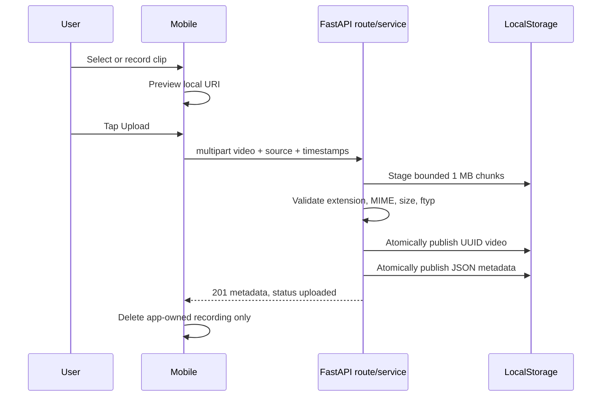

# AI Lacrosse Coach - System Architecture

**Updated:** November 10, 2026
**Status:** Milestone 2 implemented; Milestone 3 decoding, pose, and visualization foundations implemented

## Scope

Implemented now:

- Expo/React Native application with Expo Router.
- FastAPI health endpoint and trusted-LAN mobile connection.
- Photos selection and temporary in-app camera recording.
- Local preview, multipart upload progress/cancellation, and retry behavior.
- Safe local MP4/MOV persistence with JSON metadata.
- Metadata list/detail and individual deletion.
- Guarded local bulk-cleanup command.
- Streaming local MP4/MOV frame decoding and inspection with OpenCV.
- Sequential single-athlete pose detection with MediaPipe Tasks Pose Landmarker.
- Confidence-filtered skeleton-overlay MP4 generation for local inspection.

Not implemented:

- Video streaming from the backend.
- Stick tracking, movement inference, scores, or coaching feedback.
- Authentication, accounts, database, cloud storage, jobs/queues, or production deployment.

## Architectural style

The repository is a monorepo containing two independently running applications. The backend is a small modular monolith.

```text
Mobile UI
  |-- Expo Router screens
  |-- reusable preview/history components
  |-- central typed API client
  `-- Expo Camera/ImagePicker/Video/FileSystem

HTTP multipart + JSON over trusted local Wi-Fi

FastAPI
  |-- API routes: HTTP parsing/status codes
  |-- schemas: Pydantic public/internal records
  |-- service: create/list/read/delete orchestration
  `-- storage: constrained videos + atomic JSON files
```

`backend.main.create_app()` creates the storage and service and registers the router. Tests pass a `tmp_path` storage root and a smaller size limit where needed, so they cannot read or delete real uploads. The production development default resolves `services/backend/data` from the storage module's file location, not from the process working directory.

## Responsibilities

| Area | Owns | Does not own |
| --- | --- | --- |
| Mobile screens/components | Permissions, selection, recording, preview, UI states | Trusted upload validation or server paths |
| Mobile API client | Base URL, typed JSON, upload task, progress/cancel/timeout | UI rendering or binary conversion |
| API routes | Multipart/Form parsing, response models, HTTP errors | Filesystem details |
| Analysis service | Validation policy and orchestration | UI or arbitrary path resolution |
| Local storage | Bounded writes, atomic publish, JSON, safe deletion | HTTP objects beyond the upload stream |
| Vision | Local frame decoding, pose inference, and debug visualization | HTTP behavior or persisted analysis status |

## Upload sequence



The API never reads the complete video into memory. It stops when the running count exceeds 100 MB and removes the partial staging file on rejection or interruption.

## Public API

| Method | Endpoint | Response |
| --- | --- | --- |
| `GET` | `/health` | Service health |
| `POST` | `/api/v1/analyses` | `201` public analysis metadata |
| `GET` | `/api/v1/analyses` | Newest-first `{"items": [...]}` |
| `GET` | `/api/v1/analyses/{uuid}` | One public metadata record |
| `DELETE` | `/api/v1/analyses/{uuid}` | `204` |

Upload form fields:

| Field | Type | Behavior |
| --- | --- | --- |
| `video` | file | Required MP4/MOV upload |
| `source` | enum | `in_app_camera` or `photo_library` |
| `recorded_at` | datetime, optional | Must be timezone-aware; normalized to UTC |
| `original_filename` | string, optional | Validated display-only name for picker cache uploads |

Public responses contain `analysis_id`, `original_filename`, `source`, `recorded_at`, `uploaded_at`, `file_size_bytes`, `content_type`, and the only current status, `uploaded`. `stored_filename` is internal and no absolute filesystem path is exposed.

## Storage model

```text
services/backend/data/
|-- uploads/
|   |-- <uuid>.mp4
|   `-- <uuid>.mov
`-- metadata/
    `-- <uuid>.json
```

Upload files first use `.<uuid>.uploading`. Metadata uses `.<uuid>.<temp-uuid>.tmp`. `os.replace()` publishes final files atomically. The JSON record includes a trusted generated `stored_filename`; submitted names never create paths.

Deletion loads metadata by UUID, verifies that the stored video name is exactly the same UUID plus an allowed suffix, resolves it beneath the managed upload directory, then removes the video and metadata. If the video is already missing, the stale metadata is still removed. Invalid internal metadata cannot direct deletion outside managed storage.

`scripts/clear_uploads.py` reuses `LocalStorage` to enumerate only generated UUID videos, metadata, and staging files. Dry-run performs no writes. A real run requires typing `DELETE`; no network bulk-delete route exists.

## Validation boundary

Accepted containers:

- `.mp4` with `video/mp4` or `application/mp4`
- `.mov` with `video/quicktime`

The storage service keeps the first bytes while streaming. The analysis service checks that an `ftyp` box begins at the expected location and has a plausible size. This rejects text renamed to `.mp4`, but it is intentionally not a decoder. The separate local OpenCV pipeline evaluates playability, codec support, duration, and frame integrity when a video is explicitly processed.

## Mobile lifecycle

### Photos

`launchImageLibraryAsync({ mediaTypes: ['videos'], allowsEditing: false })` uses the system selection UI. The app does not add `expo-media-library`, request broad access just to browse, or delete selected URIs. Picker metadata is optional. No capture date is guessed.

### In-app recording

Camera and microphone permissions are requested when Record is selected. `CameraView` must report ready before `recordAsync()` can run. A ref prevents duplicate recording calls. Recording start time is captured immediately before the promise starts. Native progress supplies elapsed time and size. A central constant limits clips to 20 seconds without forcing an iOS video quality.

Camera recordings remain in Expo's app cache. No save-to-Photos API is called. Retake, Discard, and successful upload call the current synchronous `File.delete()` only for a draft marked app-owned. Failed/cancelled uploads retain it for retry. The draft stays in the tab's screen state while the app session keeps that screen mounted; there is no persistent offline queue.

### Upload

The client uses `new File(uri).createUploadTask()` with `UploadType.MULTIPART`, `fieldName: 'video'`, form parameters, a foreground session, native progress, cancellation, and a two-minute timeout. It does not manually set a multipart boundary. A response is successful only after a 2xx status and runtime validation of the full metadata/UUID shape.

### History

My Uploads fetches the newest-first list on focus and on pull/manual refresh. Dates use `Intl.DateTimeFormat`, which displays UTC API timestamps in the device's local timezone. Delete requires confirmation and refreshes after `204`.

## Security and deployment boundary

- Runtime data and machine-specific environment values are ignored by Git.
- Client metadata is never trusted for filesystem paths.
- `EXPO_PUBLIC_API_URL` is public configuration, not a secret.
- Upload limits are enforced during streaming, not after full buffering.
- This API has no authentication or ownership checks. It must remain on a trusted development network and must not be publicly deployed.
- Production storage, access control, HTTPS, retention, and user ownership remain future work.

## Computer vision boundary

`backend.vision.VideoReader` consumes a trusted local video path through ordinary
Python code, streams OpenCV BGR frames, and reports each frame's index and
timestamp without loading the whole clip into memory. The local
`scripts/inspect_video.py` utility exercises that boundary without FastAPI. Future
computer-vision components consume the same frame iterator.

`backend.vision.PoseTracker` converts each BGR frame to RGB and invokes MediaPipe
1.2.2 Pose Landmarker in VIDEO mode with the official Lite float16 version 1
model. It processes at most one athlete, retains both normalized image landmarks
and estimated world landmarks, and preserves visibility and presence confidence.
A frame with no detection produces an explicit result with no fabricated
landmarks; later frames continue processing normally. Source timestamps are
preserved while a separate strictly increasing millisecond timestamp satisfies
MediaPipe's video API.

`backend.vision.PoseVisualizer` converts normalized landmark coordinates into
pixels on a copy of each decoded frame. It uses MediaPipe's official pose
connections and configurable visibility/presence thresholds to omit unreliable
or out-of-bounds endpoints without changing the stored pose result. Missing-pose
frames retain the source image and may show only optional diagnostic text.

`scripts/visualize_pose.py` keeps the pipeline sequential: `VideoReader` to
`PoseTracker` to `PoseVisualizer` to an OpenCV `VideoWriter`. The MP4 writer uses
decoded dimensions for portrait and landscape sources, uses reported FPS or a
documented 30 FPS fallback, and publishes a completed temporary file atomically.
Generated overlays live in the Git-ignored backend output directory. OpenCV does
not copy source audio into these development visualizations.

Model acquisition is an explicit developer action through
`scripts/download_pose_model.py`. The script downloads a pinned official Google
asset, validates its SHA-256 checksum, and stores it under the Git-ignored backend
model directory. `scripts/inspect_pose.py` streams VideoReader output through the
tracker and reports diagnostic coverage without persisting landmarks.

Pose processing is not yet connected to uploads. Only when it is deliberately
integrated should states beyond `uploaded` and a background worker/job design be
introduced. The mobile API contract can then add real results without moving
computer-vision logic into route handlers.
